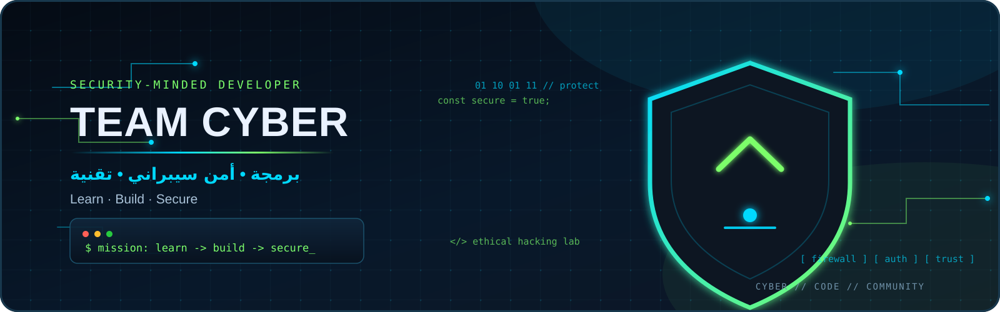

<div align="center">



# hoursiq-hub

### Cybersecurity · Programming · Technology

<p>
  <a href="https://github.com/hoursiq-hub"></a>
  
  
</p>

> **Learn · Build · Secure**

</div>

---

## About

A technical space focused on practical programming, cybersecurity, automation, and open-source learning.

The goal is simple: build useful tools, understand how systems work, and make digital projects more secure.

## Focus Areas

```text
[ Secure Software ]  [ Web Security ]  [ Linux & Networking ]
[ Python & Automation ]  [ CTF Practice ]  [ Open Source ]
```

## Tech Stack

<p>
  
  
  
  
  
  
</p>

## Working Principles

```bash
$ mission
learn -> build -> test -> secure

$ principles
ethical | practical | open-source | continuous-learning
```

- Security research is performed ethically and responsibly.
- Projects should be understandable, reusable, and documented.
- Automation should reduce repetitive work without hiding how systems operate.
- Every experiment should leave behind a useful lesson.

## Current Direction

- Building a clean foundation for cybersecurity and programming projects.
- Documenting practical experiments and technical notes.
- Exploring secure automation, web security, and developer tooling.

## Contact

For collaboration, technical discussions, or open-source projects, reach out through GitHub.

<div align="center">

**Secure the code. Protect the future.**

</div>
